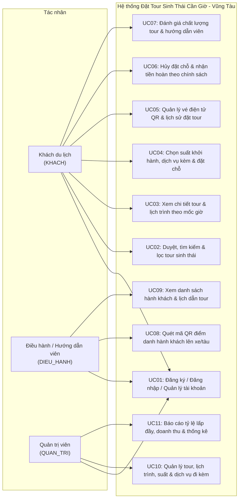

# HỒ SƠ MỐC TUẦN 9: CHỐT PHÂN TÍCH HỆ THỐNG
**Học phần:** INT4211 - Phát triển ứng dụng di động và phân tán  
**Đề tài:** Đề 23 - Hệ thống đặt tour du lịch sinh thái Cần Giờ – Vũng Tàu  
**Nhóm thực hiện:** Nhóm NoName  

---

## 1. Danh sách thành viên & Phân công nhiệm vụ chính thức (Nhóm NoName)

| STT | Mã nhóm | MSSV | Họ và tên | Vai trò | Phân công nhiệm vụ chi tiết |
| :---: | :--- | :--- | :--- | :--- | :--- |
| 1 | Nhóm NoName | **231A290089** | **Đỗ Lê Tuấn Đạt** | Nhóm trưởng / Backend & Admin Lead | - Thiết kế kiến trúc Backend Express.js & xác thực JWT<br>- Xây dựng API đặt chỗ với Transaction ACID + `SELECT ... FOR UPDATE` chống vượt số chỗ<br>- Xây dựng API hủy tour & tính tiền hoàn tự động, API báo cáo tỷ lệ lấp đầy & doanh thu<br>- Triển khai hạ tầng Backend lên Render / Supabase<br>- App Admin: Tính năng quét mã QR vé điểm danh & biểu đồ thống kê doanh thu |
| 2 | Nhóm NoName | **231A010060** | **Nguyễn Nhật Duy** | Thành viên / Database & Admin Dev | - Thiết kế CSDL PostgreSQL Supabase (`schema.sql` 13 bảng & `seed.sql` dữ liệu mẫu chuẩn Đề 23)<br>- Xây dựng RESTful API quản lý danh mục tour, điểm đến, lịch trình chi tiết<br>- App Admin: Giao diện quản lý danh sách tour, lịch trình theo giờ, suất khởi hành, phân công hướng dẫn viên và quản lý dịch vụ kèm |
| 3 | Nhóm NoName | **221A010146** | **Phan Thị Anh Thư** | Thành viên / Client Mobile Dev | - App Client (Flutter): Module xác thực người dùng (Đăng ký, Đăng nhập JWT, Lưu token bảo mật)<br>- App Client: Giao diện duyệt tour, tìm kiếm & bộ lọc đa tiêu chí (địa điểm Cần Giờ / Vũng Tàu, số ngày, khoảng giá)<br>- App Client: Màn hình chi tiết tour, hiển thị lịch trình theo mốc giờ trực quan, thông báo nhắc giờ tập trung<br>- App Client: Giao diện gửi đánh giá sao và nhận xét cho tour & HDV sau chuyến đi |
| 4 | Nhóm NoName | **231A290127** | **Bùi Quang Duy** | Thành viên / Client Mobile Dev | - App Client (Flutter): Quy trình đặt chỗ tour (chọn suất khởi hành theo lịch, chọn số lượng vé người lớn/trẻ em)<br>- App Client: Form nhập thông tin danh sách hành khách & chọn dịch vụ sinh thái đi kèm<br>- App Client: Màn hình hiển thị vé điện tử kèm mã QR Code động phục vụ check-in tại bến/xe<br>- App Client: Quản lý lịch sử các đơn đặt chỗ, tra cứu trạng thái và thao tác hủy đặt chỗ kèm xem số tiền hoàn |

---

## 2. Sơ đồ Use Case tổng thể hệ thống (11 Use Case - Đề 23)

Hệ thống phục vụ 3 nhóm tác nhân chính:
1. **`KHACH` (Khách du lịch):** Tìm kiếm tour sinh thái, đặt chỗ, lưu vé QR, đánh giá.
2. **`DIEU_HANH` (Điều hành / Hướng dẫn viên):** Quét mã QR check-in, xem danh sách hành khách theo suất.
3. **`QUAN_TRI` (Quản trị viên):** Quản trị danh mục tour, điều phối suất khởi hành, theo dõi doanh thu và tỷ lệ lấp đầy.



---

## 3. Sơ đồ Thực thể - Quan hệ (ERD 13 Bảng)

Cơ sở dữ liệu được chuẩn hóa và thiết kế tối ưu trên PostgreSQL với 13 bảng thực thể nghiệp vụ:

```mermaid
erDiagram
    nguoi_dung ||--o| huong_dan_vien : "thong_tin_hdv"
    nguoi_dung ||--o{ dat_cho : "dat_cho"
    nguoi_dung ||--o{ diem_danh_tour : "nguoi_quet_qr"

    tour ||--o{ lich_trinh : "co_lich_trinh"
    diem_den ||--o{ lich_trinh : "dia_diem"

    tour ||--o{ suat_khoi_hanh : "co_suat"
    huong_dan_vien ||--o{ suat_khoi_hanh : "dan_doan"

    suat_khoi_hanh ||--o{ dat_cho : "chua_don"
    dat_cho ||--o{ hanh_khach : "danh_sach_khach"
    dat_cho ||--o{ dat_dich_vu : "su_dung_dich_vu"
    dich_vu_kem ||--o{ dat_dich_vu : "phan_loai"

    dat_cho ||--o{ diem_danh_tour : "checkin_ve"
    hanh_khach ||--o| diem_danh_tour : "duoc_diem_danh"

    dat_cho ||--o| danh_gia : "phan_hoi"

    nguoi_dung {
        int id PK
        string email UK
        string mat_khau_hash
        string ho_ten
        string sdt
        string vai_tro
        timestamp tao_luc
    }

    diem_den {
        int id PK
        string ten
        string khu_vuc
        text mo_ta
        numeric vi_do
        numeric kinh_do
        string anh_url
    }

    tour {
        int id PK
        string ten
        text mo_ta
        int so_ngay
        numeric gia_nguoi_lon
        numeric gia_tre_em
        string anh_url
        string trang_thai
    }

    lich_trinh {
        int id PK
        int tour_id FK
        int ngay_thu
        int thu_tu
        string gio
        text hoat_dong
        int diem_den_id FK
    }

    huong_dan_vien {
        int id PK
        int nguoi_dung_id UK_FK
        string ho_ten
        string ngon_ngu
        string chung_chi
        string sdt
    }

    suat_khoi_hanh {
        int id PK
        int tour_id FK
        date ngay_di
        string gio_tap_trung
        string diem_tap_trung
        string phuong_tien
        int so_cho
        int hdv_id FK
        string trang_thai
    }

    dat_cho {
        int id PK
        int suat_id FK
        int khach_id FK
        int so_nguoi_lon
        int so_tre_em
        numeric tong_tien
        numeric tien_hoan
        string ma_ve UK
        string trang_thai
        timestamp dat_luc
    }

    hanh_khach {
        int id PK
        int dat_cho_id FK
        string ho_ten
        int nam_sinh
        string cccd
        string loai_ve
    }

    dich_vu_kem {
        int id PK
        string ten
        numeric gia
        string don_vi
    }

    dat_dich_vu {
        int id PK
        int dat_cho_id FK
        int dich_vu_id FK
        int so_luong
    }

    diem_danh_tour {
        int id PK
        int dat_cho_id FK
        int hanh_khach_id FK
        timestamp thoi_diem
        int nguoi_quet_id FK
    }

    chinh_sach_huy {
        int id PK
        int so_gio_truoc UK
        int phan_tram_hoan
    }

    danh_gia {
        int id PK
        int dat_cho_id UK_FK
        int so_sao_tour
        int so_sao_hdv
        text noi_dung
        string anh_url
        timestamp tao_luc
    }
```

---

## 4. Tóm tắt giải pháp kỹ thuật chính

1. **Chống vượt số chỗ (Overbooking Prevention):**
   - Áp dụng Transaction trong PostgreSQL với mức cô lập mạnh, sử dụng câu lệnh `SELECT so_cho FROM suat_khoi_hanh WHERE id = $1 FOR UPDATE`.
   - Tính toán trực tiếp số ghế đã đặt bằng lệnh tổng hợp:
     `SELECT COALESCE(SUM(so_nguoi_lon + so_tre_em), 0) FROM dat_cho WHERE suat_id = $1 AND trang_thai != 'DA_HUY'`.
   - Nếu `so_cho_con_lai < so_nguoi_lon + so_tre_em`, hệ thống tự động Rollback và trả về HTTP Status `409 Conflict`.

2. **Chính sách hoàn tiền khi hủy tour:**
   - Tra cứu bảng `chinh_sach_huy` theo khoảng thời gian còn lại tính từ thời điểm hủy đến `ngay_di` + `gio_tap_trung`.
   - Tính toán chính xác giá trị `tien_hoan` và cập nhật trạng thái đơn đặt thành `DA_HUY`.

3. **Vé điện tử QR & Check-in:**
   - Mã vé định dạng chuẩn duy nhất (ví dụ: `ECO-YYYYMMDD-XXXX`), mã hóa thành chuỗi QR.
   - Ứng dụng Admin quét mã, kiểm tra và lưu lịch sử vào bảng `diem_danh_tour` kèm ID người quét và mốc thời gian thực.
